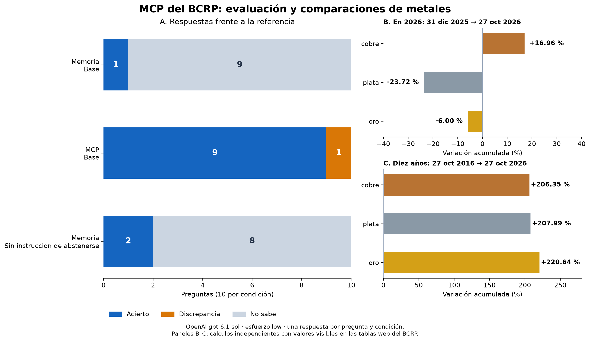

# MCP del BCRP con OpenAI / Codex

Servidor MCP para consultar series oficiales del Banco Central de Reserva del Perú y medir si su acceso mejora las respuestas de un modelo.

La **referencia principal** es la [presentación de clase](https://claude.ai/artifact/B9W8izJCRr6qsTLwbMXqcT).
El [repositorio compartido](https://github.com/d2cml-ai/Data-Science-Python/tree/main/sessions/04-mcp-claude-code) aportó los archivos base.
El enunciado se conserva en [ENUNCIADO_ORIGINAL.md](ENUNCIADO_ORIGINAL.md). Adaptamos la conexión y la evaluación de Claude Code a OpenAI mediante Codex.

## Resultado de la corrida guardada

| Condición | Aciertos | Discrepancias | No sabe |
|---|---:|---:|---:|
| Memoria, con instrucción de abstenerse | 1/10 | 0 | 9 |
| MCP del BCRP | 9/10 | 1 | 0 |
| Memoria, sin esa instrucción | 2/10 | 0 | 8 |

Mismo modelo `gpt-6.1-sol`, esfuerzo `low`, sesiones independientes y sin acceso a las respuestas de referencia.
La discrepancia del cobre se debe a la selección de la serie LME frente al precio de exportación esperado por el curso; ambos indicadores son del BCRP.
Una consulta aclarada con la palabra «exportación» acertó. Ese diagnóstico no reemplazó la corrida base.

- [Informe completo](informe.md).
- [Resultados base](resultados.csv), [experimento adicional](resultados_sin_abstencion.csv) y [diagnóstico](resultados_diagnostico.csv).
- [Evidencias de las llamadas y respuestas](evidencia_evaluacion/).
- [Referencias verificadas en la web](referencias_verificadas.csv) y [comparaciones de los metales](verificacion_web/comparaciones.json).



## Qué ofrece el MCP

| Componente | Función |
|---|---|
| `buscar_series` | Busca códigos, nombres y frecuencias en el catálogo oficial. |
| `serie` | Consulta valores diarios, mensuales, trimestrales o anuales y devuelve la fuente. |
| `resumen` | Calcula cambios, promedio y extremos con sus periodos. |
| `comparar_series` | Compara cambios porcentuales usando fechas comunes entre dos series. |
| `bcrp://serie/{codigo}` | Recurso con la ficha de una serie. |
| `informe(tema)` | Prompt reutilizable para preparar un informe con fuentes. |

## Instalar y conectar

Requisitos: Python 3.11 o superior, uv, Codex CLI con una sesión iniciada e internet.

```powershell
git clone https://github.com/bocchienjoyer/mcp-bcrp.git
cd mcp-bcrp
uv sync --frozen
uv run --frozen pytest -q
```

Las ocho pruebas originales de `test_server.py` se conservan sin cambios y pasan.
Hay 27 comprobaciones complementarias; el total actual es 35 aprobadas.
Consulta [CONEXION.md](CONEXION.md) para registrar `bcrp` y `fetch`, recargar la conexión y comprobar `/mcp`.
`.mcp.json` conserva la configuración compatible con el recorrido original de Claude; `codex-mcp.example.toml` muestra la equivalente para Codex.

## Usarlo conversando

Con el MCP activado, pregunta normalmente. Por ejemplo:

- ¿Cuánto está la plata hoy?
- ¿Qué subió más entre el cierre de 2025 y el 27 de octubre de 2026: cobre, plata u oro?
- ¿Cuál de esos tres creció más entre el 27 de octubre de 2016 y el 27 de octubre de 2026?

El asistente debe consultar las herramientas y responder con fecha, unidad, código y fuente.
«Hoy» puede devolver el último dato publicado por el BCRP; debe indicarse la fecha real del dato.
La [guía sencilla](GUIA.md) explica las piezas sin asumir conocimientos previos.

## Repetir la evaluación

```powershell
uv run --frozen verificar_referencias.py
uv run --frozen evaluar.py
uv run --frozen evaluar.py --experimento sin_abstencion --modos memoria
uv run --frozen auditar_resultados.py
uv run --frozen generar_informe.py
```

Se ejecutan 20 llamadas base y 10 del experimento. Usa la sesión de ChatGPT de Codex; no requiere agregar una clave de OpenAI.
Una nueva corrida consume uso del modelo y puede producir respuestas y tiempos distintos.
Para regenerar la figura y el informe desde los resultados incluidos basta ejecutar `generar_informe.py`.

El diagnóstico opcional, separado de la puntuación base, se repite con:

```powershell
uv run --frozen evaluar.py --preguntas preguntas_diagnostico.csv --ids cobre_ago26 --modos mcp
```

`verificar_referencias.py` lee tablas HTML del BCRP independientemente de nuestro servidor.
Guarda los valores visibles, sus enlaces y huellas de las páginas en `verificacion_web/`.
También se contrastaron dos tablas en el navegador: [registro](verificacion_web/comprobacion_visual.md).
Las carpetas de datos descargados, entornos, registros brutos y copias HTML quedan excluidas de Git.
